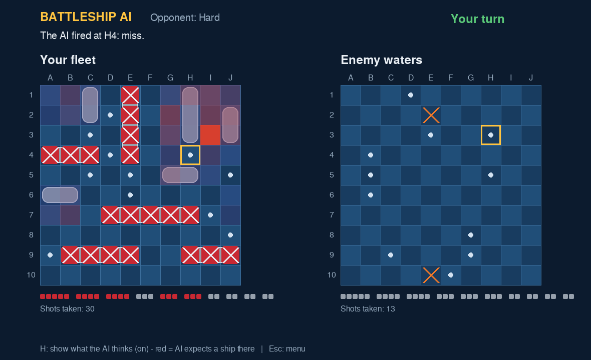
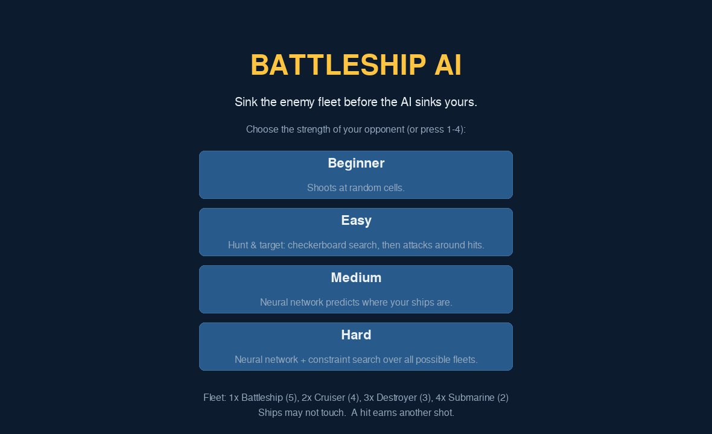
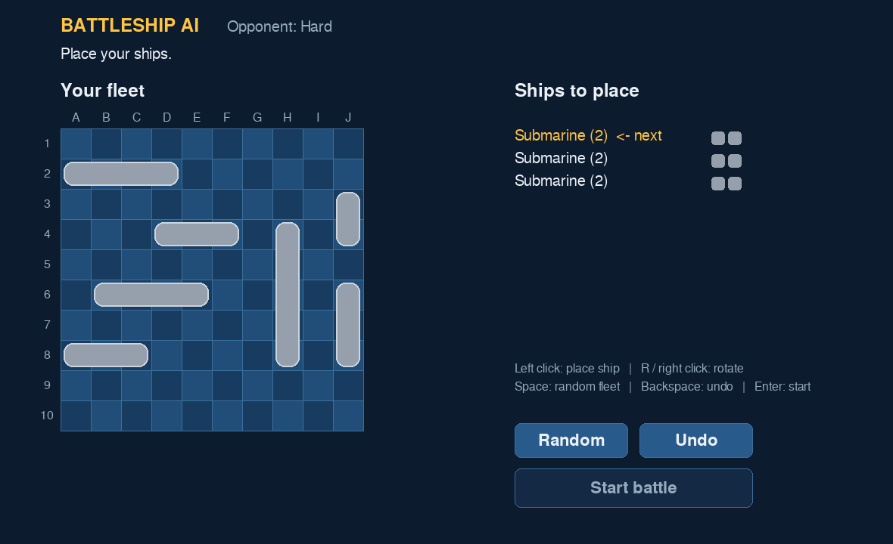
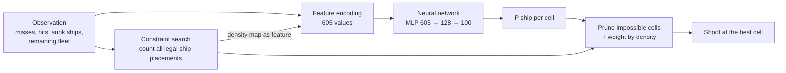
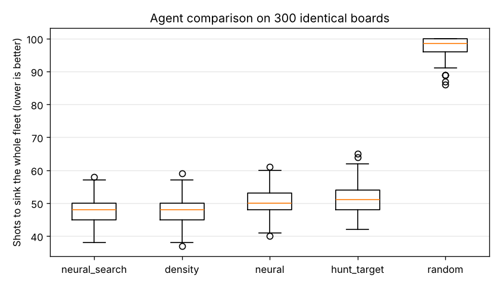

# Battleship AI – Schiffe versenken against a data-driven opponent

[](https://github.com/nicomirsberger/Schiffe_Versenken/actions/workflows/ci.yml)


A desktop Battleship game (German: *Schiffe versenken*) in which you play
against an AI opponent. The strongest opponent is a **neural network trained on
simulated games** and combined with a **constraint search** over every
possible ship placement. The development of the AI follows the
**CRISP-DM** process model and is documented step by step.



*Left: your fleet. The red overlay (key `H`) shows where the AI currently
expects your ships. Right: the enemy waters you are shooting at.*

---

## Contents

- [Features](#features)
- [Quick start](#quick-start)
- [How to play](#how-to-play)
- [How the AI works](#how-the-ai-works)
- [Results](#results)
- [CRISP-DM in a nutshell](#crisp-dm-in-a-nutshell)
- [Project structure](#project-structure)
- [Reproducing the model](#reproducing-the-model)
- [Development](#development)
- [Documentation](#documentation)

## Features

- Full Battleship game with a graphical user interface (pygame)
- Classic German rules: 10×10 board, ten ships (1×5, 2×4, 3×3, 4×2),
  ships must not touch, a hit earns another shot. All rules are configurable
  in [`battleship/config.py`](battleship/config.py).
- Four difficulty levels from a random shooter to the neural network with search
- **Explainable AI view:** press `H` to see the AI's probability map
- A reproducible machine learning pipeline (data generation → analysis → training → evaluation)
- Modular architecture: game rules, AI, data, training and UI are separate packages
- 52 automated tests, linting and continuous integration via GitHub Actions

## Quick start

Requires Python 3.10 or newer.

```bash
git clone https://github.com/nicomirsberger/Schiffe_Versenken.git
cd Schiffe_Versenken
python -m venv .venv
source .venv/bin/activate          # Windows: .venv\Scripts\activate
pip install -r requirements.txt
python main.py
```

The trained model (`models/cell_model.joblib`) is part of the repository, so the
game runs immediately without training.

## How to play

| Screen | Controls |
|---|---|
| Menu | Click a difficulty or press `1`–`4` |
| Fleet setup | Left click: place ship · `R` / right click: rotate · `Space`: random fleet · `Backspace`: undo · `Enter`: start |
| Battle | Click a cell in *Enemy waters* to fire · `H`: show what the AI thinks · `Esc`: back to menu |

| Level | Opponent | Avg. shots to win* |
|---|---|---|
| Beginner | Random shots | 97.7 |
| Easy | Hunt & target (checkerboard search, then attacks around hits) | 51.6 |
| Medium | Neural network | 50.2 |
| Hard | Neural network + constraint search | **47.8** |

\* Average number of shots needed to sink the complete fleet, measured on 300
boards (fewer is better).

<p align="center">
  
  
</p>

## How the AI works

Battleship is a game of **hidden information**: the AI cannot see your ships,
it has to *estimate* where they are. Every AI opponent in this project solves
the same task:

> Given what is known about the board (misses, hits, sunk ships, remaining
> ships), how likely is it that each unknown cell contains a ship?

The AI then shoots at the most likely cell.



1. **Constraint search** ([`game/knowledge.py`](battleship/game/knowledge.py)) –
   for every remaining ship, all positions on the board are enumerated and checked
   against the known facts and the no-touch rule. The number of legal placements
   that cover a cell is a strong probability estimate (*density*).
2. **Neural network** ([`ai/model.py`](battleship/ai/model.py)) – a
   multi-layer perceptron (scikit-learn) with 100 sigmoid outputs, one per cell.
   It was trained on about 200,000 game situations to predict the true positions of
   the hidden ships. Its input is the board state plus the density map from step 1.
3. **Combination** ([`ai/neural.py`](battleship/ai/neural.py)) – on the
   *Hard* level, the network's probabilities are multiplied with the density map
   ("product of experts"). Cells that the search rules out are never chosen.

## Results

All numbers come from `python -m battleship evaluate` and are stored in
[`reports/results.md`](reports/results.md).

**Offline metrics** on 1,800 held-out test games (only cells that were still unknown are scored):

| Model | ROC AUC | Log loss | Brier | Next-shot hit rate |
|---|---:|---:|---:|---:|
| Prior (cell frequency) | 0.556 | 0.552 | 0.183 | 26.9 % |
| Constraint search | 0.747 | 0.899 | 0.186 | 61.2 % |
| **Neural network** | **0.789** | **0.425** | **0.147** | **67.1 %** |
| Neural network + search | 0.755 | 0.959 | 0.190 | 64.0 % |

**Game performance** on 300 identical boards (shots to sink the fleet, lower is better):



**Key insight:** the neural network is the best *predictor* offline, but alone
it does not play best. Its training data came from other agents' games. When
it plays itself, it creates situations it has seen less often (distribution
shift). Combining it with the constraint search gives the strongest
opponent. The search's rules prevent the network's mistakes in situations it
knows less well. See [docs/CRISP-DM.md](docs/CRISP-DM.md#5-evaluation) for the full discussion.

## CRISP-DM in a nutshell

| Phase | In this project |
|---|---|
| 1. Business understanding | Build an opponent that is challenging but beatable; success = fewer shots than a human-like strategy (hunt & target) |
| 2. Data understanding | No dataset exists → generate data by simulating 12,000 games; analyse class balance, game length and ship position frequencies |
| 3. Data preparation | Encode boards as 605 features, label = true ship positions; split **by game** to avoid leakage |
| 4. Modeling | Multi-label MLP; hyperparameter comparison; custom early stopping |
| 5. Evaluation | Offline metrics vs. baselines **and** real games on identical boards |
| 6. Deployment | Pygame desktop game with four difficulty levels and an explainable heatmap |

The project went through **three iterations** of the cycle. The detailed
documentation is in [docs/CRISP-DM.md](docs/CRISP-DM.md).

## Project structure

```
Schiffe_Versenken/
├── main.py                  # starts the game
├── battleship/
│   ├── config.py            # all game rules in one place
│   ├── __main__.py          # command line interface (play / generate / train / ...)
│   ├── game/                # rules only – no AI, no UI
│   │   ├── board.py         #   board, ships, shots, observation
│   │   ├── placement.py     #   placement rules, random fleets
│   │   ├── knowledge.py     #   logical deductions + constraint search
│   │   └── match.py         #   turn order of a game, simulation
│   ├── ai/                  # opponents
│   │   ├── base.py          #   common Agent interface
│   │   ├── heuristic.py     #   random and hunt & target agents
│   │   ├── density.py       #   search agent
│   │   ├── model.py         #   neural network (training, saving, loading)
│   │   ├── neural.py        #   neural network agent
│   │   └── factory.py       #   difficulty levels
│   ├── data/                # data generation and feature engineering
│   ├── training/            # training, metrics, evaluation, analysis
│   └── ui/                  # pygame interface
├── models/                  # trained model
├── reports/                 # metrics (JSON/Markdown) and figures
├── docs/                    # CRISP-DM documentation, quality, screenshots
└── tests/                   # pytest test suite
```

Dependencies only point in one direction: `ui → ai → data → game`. The game
rules know nothing about the AI, and the AI knows nothing about the user
interface. Every agent implements the same interface, so a new opponent can be
added without changing the game or the UI. For details, see
[docs/ARCHITECTURE.md](docs/ARCHITECTURE.md).

## Reproducing the model

The full pipeline is available as command line commands:

```bash
# Iterations 1 + 2: simulate 8,000 games, analyse, train, evaluate
python -m battleship pipeline --games 8000

# Iteration 3: let the trained model play 4,000 games itself and add them
python -m battleship generate --iterate --games 4000
python -m battleship analyze
python -m battleship train
python -m battleship evaluate --games 300
```

| Command | Output |
|---|---|
| `generate` | `data/processed/dataset.npz` (+ CSV with sample and game metadata) |
| `analyze` | `reports/data_summary.json`, data understanding figures |
| `train` | `models/cell_model.joblib`, `reports/training_report.json`, training curve |
| `evaluate` | `reports/evaluation.json`, `reports/results.md`, comparison figures |

All random processes are seeded, so results are reproducible. Generating the data
takes about 15 minutes on a laptop, and training takes less than a minute.

## Development

```bash
pip install -r requirements-dev.txt
pytest                 # 52 tests (rules, agents, data pipeline, UI smoke test)
ruff check .           # linting
ruff format .          # formatting
```

GitHub Actions runs linting and tests on Python 3.10 and 3.12 for every push.

## Documentation

- [docs/CRISP-DM.md](docs/CRISP-DM.md) – detailed walkthrough of all six phases and three iterations
- [docs/ARCHITECTURE.md](docs/ARCHITECTURE.md) – modules, interfaces and design decisions
- [docs/QUALITY.md](docs/QUALITY.md) – how the project addresses software and data science quality criteria
- [reports/results.md](reports/results.md) – latest evaluation results

## License

[MIT](LICENSE) © 2026 Nico Mirsberger
