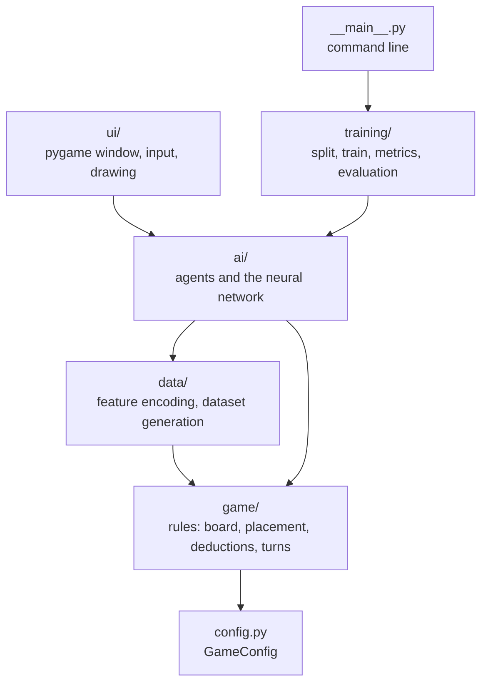
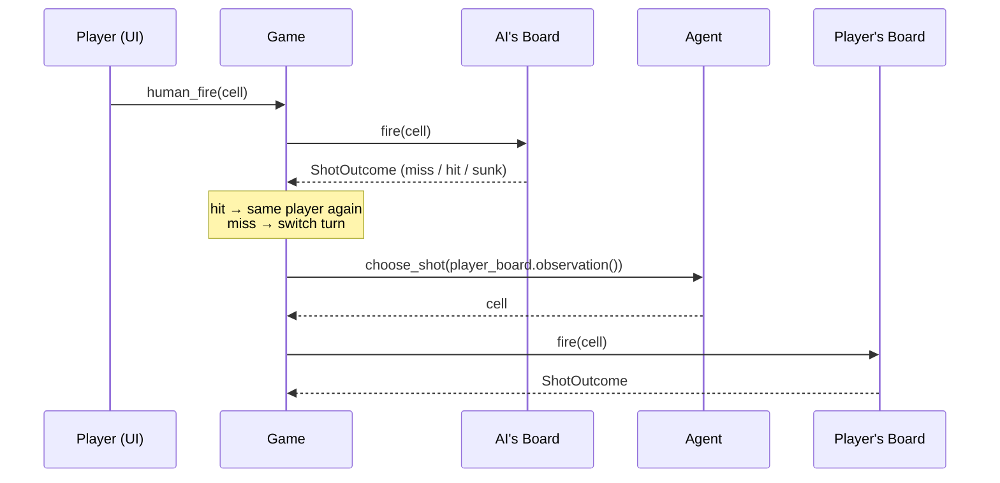

# Architecture

## Layers

The code is split into packages that each have exactly one responsibility.
Dependencies only point **downwards**. A lower layer never imports from a higher one.



| Package | Responsibility | Knows nothing about |
|---|---|---|
| `config.py` | Board size, fleet, rule variants (`GameConfig`) | everything else |
| `game/` | Rules of Battleship: placing ships, firing, turn order, logical deductions | AI, UI, machine learning |
| `data/` | Converting observations into numbers, generating datasets | UI |
| `ai/` | Agents that choose a shot, the learned model | UI |
| `training/` | Data split, training loop, metrics, figures | UI |
| `ui/` | Pygame window, user input | how an agent decides |

## Central interfaces

### `Observation` – what an attacker may see

```python
@dataclass(frozen=True)
class Observation:
    grid: np.ndarray  # size x size, CellState values (UNKNOWN, MISS, HIT, SUNK)
    remaining: tuple[int, ...]  # lengths of ships that are still afloat
    config: GameConfig
```

Agents only receive an `Observation`, never the `Board` itself. This makes
cheating structurally impossible: the hidden ship positions are not accessible.

### `Agent` – every opponent

```python
class Agent(ABC):
    last_scores: np.ndarray | None  # score map of the last decision (for the heatmap)

    @abstractmethod
    def choose_shot(self, obs: Observation, rng: np.random.Generator) -> Coord: ...
```

The game, the simulation, the data generation and the evaluation all use only this
interface. A new opponent is one new class plus one line in `ai/factory.py`.

### `GameConfig` – rules in one place

All modules receive the configuration instead of hard-coding rules.
The tests use a small 6×6 board with three ships, so they run fast,
and the same code runs on the default 10×10 board.

## Design decisions

| Decision | Reason |
|---|---|
| **scikit-learn MLP instead of PyTorch/TensorFlow** | The model is small. scikit-learn is easy to install, needs no GPU and is enough for the task. |
| **Constraint search lives in `game/knowledge.py`, not in `ai/`** | It is pure rule logic. It is used both as a feature (`data/`) and as an agent (`ai/`), and putting it in `game/` avoids circular imports. |
| **Own training loop with `partial_fit`** | scikit-learn's early stopping uses exact-match accuracy for multi-label problems, which is useless here (see CRISP-DM, iteration 1). |
| **Model stores its `GameConfig` and feature version** | A model trained for different rules or features is detected and rejected on load instead of silently making wrong predictions. |
| **Fallback to the search agent** | The game stays playable even if the model file is missing or broken. |
| **Seeded random number generators everywhere** | Data, training and evaluation are reproducible. Agents get the RNG passed in instead of using global state. |
| **Generated data is not committed** | 36 MB that can be reproduced with one command. The trained model (1.3 MB) and all reports are committed. |

## Flow of a turn in the game


