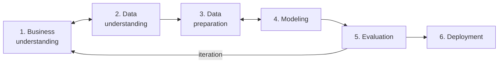
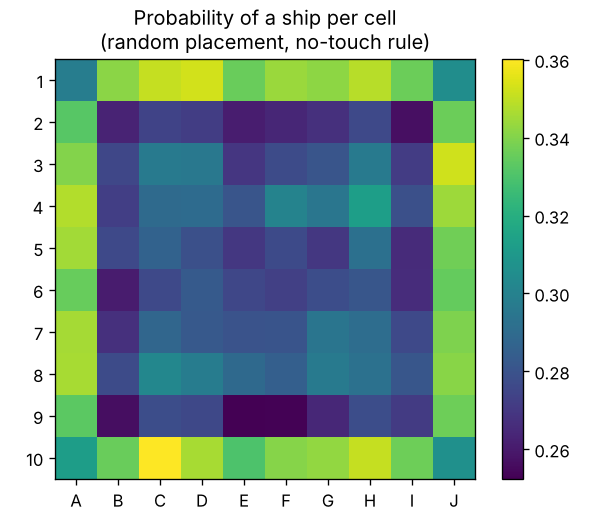
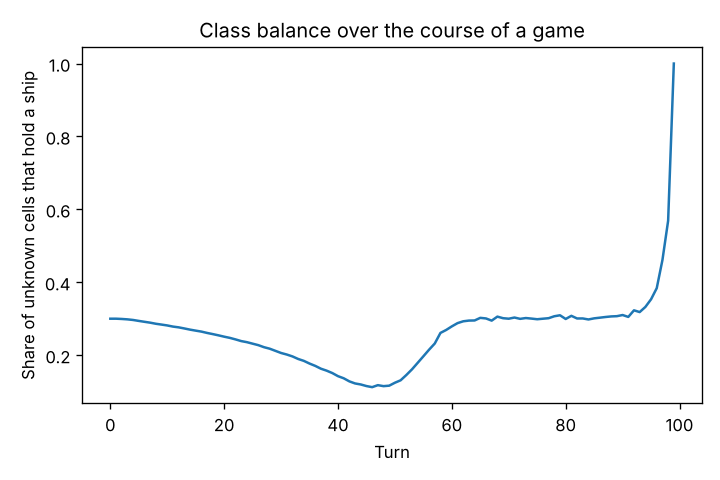
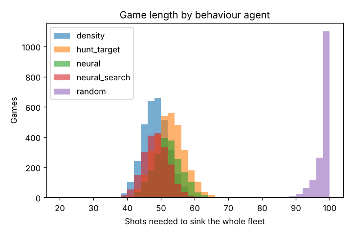
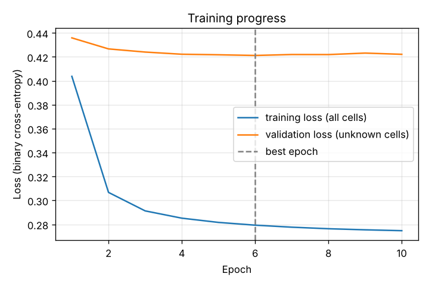
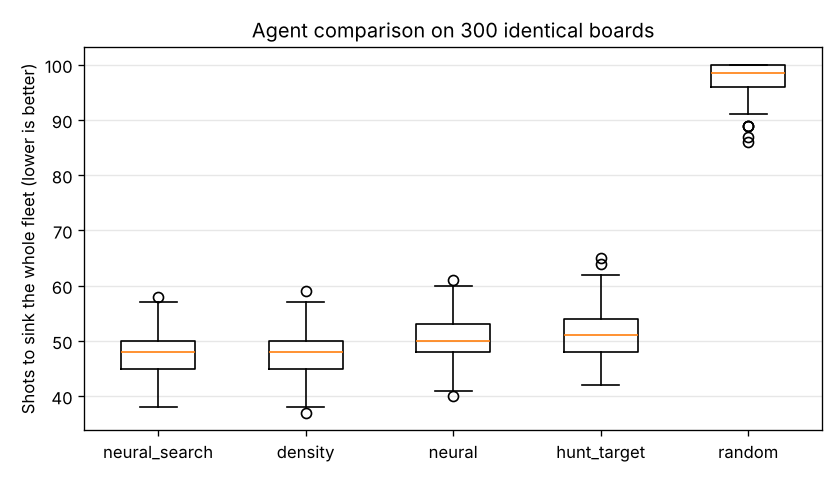
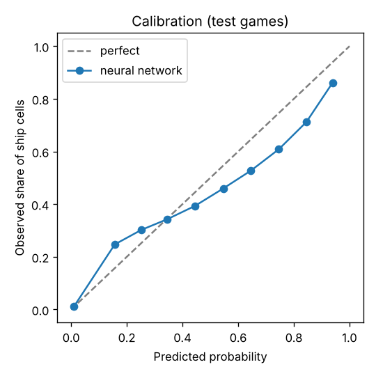

# AI development along CRISP-DM

This document describes how the AI opponent was developed using the
**CRISP-DM** process (*Cross-Industry Standard Process for Data Mining*). The six
phases were not run once from start to finish. The process went through **three
iterations**, and each one was triggered by a finding in the evaluation phase.

---

## 1. Business understanding

**Goal.** A Battleship game in which a human plays against a computer opponent.
The opponent should

- be **strong**: clearly better than a typical human strategy,
- be **adjustable**: several difficulty levels, so that beginners can win too,
- **decide quickly**: well under 100 ms per move, so the game feels fluid,
- be **explainable**: the player should be able to see why the AI shoots where it does.

**Translation into a data mining problem.** The opponent's ships are hidden, so
the AI's real task is a *prediction problem*:

> For every unknown cell, predict the probability that it contains a ship,
> given everything that is visible on the board.

This is a **multi-label binary classification** with 100 outputs (one per cell).

**Success criteria.**

| Criterion | Metric | Target |
|---|---|---|
| Playing strength | Average number of shots to sink the whole fleet | Better than *hunt & target* (≈ 51.6) |
| Prediction quality | ROC AUC / log loss on unknown cells | Better than the baselines |
| Speed | Time per decision | < 100 ms |

**Baselines.** To judge whether learning is worth the effort at all, three non-learning
opponents serve as benchmarks: random shooting, *hunt & target* (the classic
human strategy) and a *constraint search* that counts all legal ship
placements.

## 2. Data understanding

**No dataset available → generate data.** There is no public dataset of
Battleship games with these exact rules. The data is therefore created by
**simulation** ([`data/generate.py`](../battleship/data/generate.py)):

- A random, rule-conforming fleet is placed on a board.
- A *behaviour agent* plays the game (mix: 20 % random, 40 % hunt & target, 40 % search).
  Using different agents means the data covers different kinds of game situations
  (early game, hunting, targeting a wounded ship, late game).
- Before each shot, a **snapshot** is stored with 30 % probability: what the
  attacker sees (input) and where the ships really are (label).

**Dataset (final, after iteration 3).** 12,000 games, 201,846 snapshots, 605
features, 100 labels per snapshot (see [`reports/data_summary.json`](../reports/data_summary.json)).

**Findings.**

| Observation | Consequence |
|---|---|
| Only **23 %** of the unknown cells contain a ship → imbalanced labels | Use AUC, log loss and Brier score instead of accuracy |
| The share of ship cells among unknown cells **changes during a game** (see figure) | The model needs to know the game phase → the remaining fleet becomes a feature |
| In **70 %** of the snapshots there is an unsunk hit | The "targeting" situation is very common, so it must be predicted well |
| Ships are **more likely at the edges** than in the centre (see figure) | Counter-intuitive, caused by the no-touch rule: a ship in the middle "blocks" more space. A model can learn this, while the hunt & target heuristic ignores it. |

| Ship frequency per cell | Class balance during a game |
|---|---|
|  |  |

## 3. Data preparation

**Feature encoding** ([`data/features.py`](../battleship/data/features.py)), 605 values in total:

| Block | Values | Description |
|---|---:|---|
| Cell states (one-hot) | 400 | unknown / miss / hit / sunk for each of the 100 cells |
| Known empty cells | 100 | cells that are certainly empty according to the rules (around sunk ships, diagonal to hits) |
| Search density | 100 | number of legal ship placements per cell, scaled to [0, 1] *(added in iteration 2)* |
| Remaining fleet | 5 | share of ships of each length that are still afloat |

**Label.** A 100-dimensional 0/1 vector with the true ship positions.

**Train / validation / test split: by game, not by snapshot.** All snapshots of a
game share the same hidden board. A random split by snapshot would put the
*same* board into training and test data, and the model could memorise it
(**data leakage**). The data is therefore split by game: 70 % train, 15 %
validation and 15 % test. A test checks this
([`tests/test_data.py`](../tests/test_data.py)).

**Evaluation mask.** Cells that are already revealed are trivial to predict.
All metrics only consider cells that were still **unknown** in the
snapshot, because otherwise they would look much better than they are.

## 4. Modeling

**Model choice.** A multi-layer perceptron (`sklearn.neural_network.MLPClassifier`)
with 100 sigmoid outputs:

- It handles multi-label outputs natively and can learn non-linear relationships between cells.
- It is small and fast (< 1 ms per prediction), with no GPU needed.
- It has few dependencies and is easy to reproduce.

**Training procedure** ([`ai/model.py`](../battleship/ai/model.py)). An own
epoch loop with `partial_fit`. After each epoch the validation log loss on the
unknown cells is computed, the best epoch is kept, and training stops after 4
epochs without improvement (early stopping).

**Hyperparameter comparison (iteration 2, 100 boards).**

| Hidden layers | L2 (alpha) | Test AUC | Shots (neural) | Shots (neural + search) |
|---|---|---:|---:|---:|
| 256, 256 | 0.001 | 0.786 | 51.80 | 48.11 |
| 512, 256 | 0.01 | 0.786 | 52.07 | 48.10 |
| **128** | **0.001** | **0.792** | **51.23** | **47.81** |

The *smallest* network performed best. More capacity only led to faster
overfitting: the validation loss rose again after 2–3 epochs.

**Final model:** 1 hidden layer with 128 neurons, alpha = 0.001, Adam, batch size 256,
best epoch 6 of 10, training time ≈ 20 s.

## 5. Evaluation

Two complementary evaluations ([`training/evaluate.py`](../battleship/training/evaluate.py)):

1. **Offline:** prediction quality on the 1,800 held-out test games.
2. **In the game:** every agent plays on the **same 300 boards**, which makes the
   comparison fair (paired comparison).

### Final results

| Model | ROC AUC | Log loss | Brier | Next-shot hit rate |
|---|---:|---:|---:|---:|
| Prior (cell frequency) | 0.556 | 0.552 | 0.183 | 26.9 % |
| Constraint search | 0.747 | 0.899 | 0.186 | 61.2 % |
| **Neural network** | **0.789** | **0.425** | **0.147** | **67.1 %** |
| Neural network + search | 0.755 | 0.959 | 0.190 | 64.0 % |

*Next-shot hit rate: if the AI shoots at the cell with the highest predicted
probability, how often is there a ship?*

| Agent | Mean shots | Std | Min | Max |
|---|---:|---:|---:|---:|
| **Neural network + search** | **47.78** | 3.45 | 38 | 58 |
| Constraint search | 47.82 | 3.61 | 37 | 59 |
| Neural network | 50.20 | 3.79 | 40 | 61 |
| Hunt & target | 51.57 | 4.33 | 42 | 65 |
| Random | 97.68 | 2.63 | 86 | 100 |

### Interpretation

- **All success criteria are met.** The *Hard* opponent needs 3.8 shots fewer than
  hunt & target, and the network beats all baselines in every offline metric.
  A decision takes about 3 ms (neural network + search).
- **Calibration: good at low, overconfident at high probabilities.** Up to about
  35 % the predictions match reality well. Above that, the network is
  overconfident: of the cells predicted at 60 %, only about 46 % contain a ship.
  For choosing the next shot only the *ranking* of the cells matters, so this does
  not affect playing strength. It does mean that the heatmap in the game shows a
  ranking, not exact probabilities. Calibration could be improved with Platt
  or isotonic scaling (see *Outlook*).
- **Offline ≠ online.** The network alone is clearly the best *predictor*
  (67 % vs. 61 % hit rate), yet it needs *more* shots than the search. The reason
  is distribution shift (explained in iteration 3). The offline metric does not fully
  measure the business goal, so the in-game evaluation is essential.
- **Neural network + search vs. search alone.** The combination is the best agent
  on average, but the difference to the pure search (0.04 shots) is **not
  significant**. In the paired comparison, the combination wins on 45.7 % of the boards
  and the search on 47.7 %. The honest conclusion: the learned model reaches the level
  of a carefully engineered search algorithm and beats every simpler
  strategy, but it does not clearly beat the search.
- **Why the combined offline metrics are worse.** Multiplying two probability
  estimates distorts the probability scale, so the combination is not
  calibrated. Its job is only to *rank* the cells for the next shot.

### The three iterations

| | Iteration 1 | Iteration 2 | Iteration 3 |
|---|---|---|---|
| **Trigger** | – | Network alone much weaker than the search | Offline good, in-game weaker (distribution shift) |
| **Change** | Raw board as features; sklearn's built-in early stopping | **Feature engineering:** search density as input; 8,000 instead of 3,000 games; own early stopping; smaller network | **Self-play data:** 4,000 games played by the model itself added to the dataset (DAgger principle) |
| **Samples** | 53,353 | 142,522 | 201,846 |
| **Test AUC** | 0.743 → 0.764¹ | 0.792 | 0.789 |
| **Log loss** | 0.749 → 0.468¹ | 0.435 | **0.425** |
| **Shots: neural** | 55.86 | 51.10 | **50.20** |
| **Shots: neural + search** | 48.38 | 47.92 | **47.78** |

¹ Within iteration 1, the training procedure was corrected. scikit-learn's built-in
early stopping uses *exact-match accuracy* for multi-label problems (all
100 cells correct at once). This value is practically always 0, so it never stopped
training, and the model overfitted heavily (log loss 0.75). It was replaced by an own
epoch loop that stops on validation log loss.

**Iteration 2 → why feature engineering?** The network had to learn the
geometric rules (ship lengths, no-touch rule) from scratch. The search
already computes them exactly. With the density map as input, the network
only has to learn *corrections* to the search, for example the edge
effect or correlations between ships. Result: −4.8 shots for the network alone.

**Iteration 3 → why self-play?** The training snapshots come from games of
*other* agents. When the network plays itself, it reaches board states that
are rare in this data, and its predictions become less reliable there. Adding
games that the model played itself (a simplified form of DAgger, *Dataset
Aggregation*) closes this gap. Result: −0.9 shots for the network alone.

### Limitations

- The training data comes from **random fleet placement**. Human players
  place ships differently: they avoid edges, keep distances and follow patterns. A model
  trained on real human games could exploit this. The UI could collect these games
  (see *Outlook*).
- The fleet and board size are fixed. A different configuration requires new data
  and a new model. The code checks this and refuses incompatible models.

## 6. Deployment

- **Product:** pygame desktop game ([`ui/`](../battleship/ui)) with four
  difficulty levels. The model is a 1.3 MB file in the repository, so no training
  is needed to play.
- **Explainability:** key `H` shows the AI's current probability map
  over the player's board.
- **Robustness:** if the model file is missing or incompatible, the game
  automatically uses the search agent and shows a warning.
- **Reproducibility:** the whole pipeline is available as CLI commands
  (`python -m battleship pipeline`). All random processes are seeded, and metrics and
  figures are written to `reports/`.
- **Quality assurance:** automated tests and linting run in GitHub Actions on every push.

### Outlook (possible next iteration)

1. Log human games in the UI and learn **human placement patterns**.
2. Make the AI's **own fleet placement** harder to find, for example by placing
   ships where the trained model expects them least.
3. Use a convolutional network (CNN) that takes the 2-D structure of the board into account directly.
4. Calibrate the network's probabilities (Platt / isotonic scaling) so the heatmap
   shows exact probabilities.
